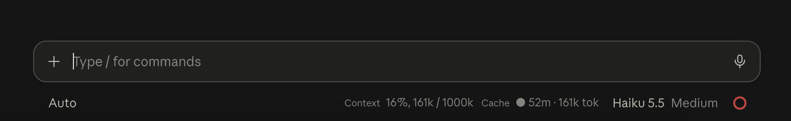
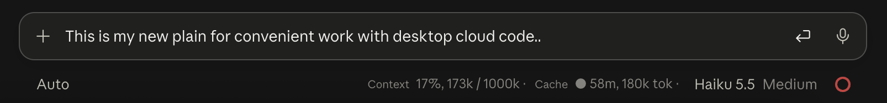

# claude-mods

Two small Claude Code mods (plugins) that show status under the prompt:

- **Cache**: minutes left until the prompt cache cools, tokens in context, a Compact button and a reminder 5 minutes before the cache goes cold.
- **Context**: context window fill of the current session.





## Install

```bash
claude plugin marketplace add Clleo/claude-mods
claude plugin install Cache@claude-mods
claude plugin install Context@claude-mods
```

Reinstall after a reset:

```bash
claude plugin marketplace update claude-mods
claude plugin install Cache@claude-mods
```

Then run `/reload-plugins` or restart the session.

## Layout

```
.claude-plugin/marketplace.json   marketplace listing both plugins
Cache/                            plugin: prompt cache timer
Context/                          plugin: context fill
```

Each plugin has its own `.claude-plugin/plugin.json` and `hooks/register.(ts|tsx)`.
